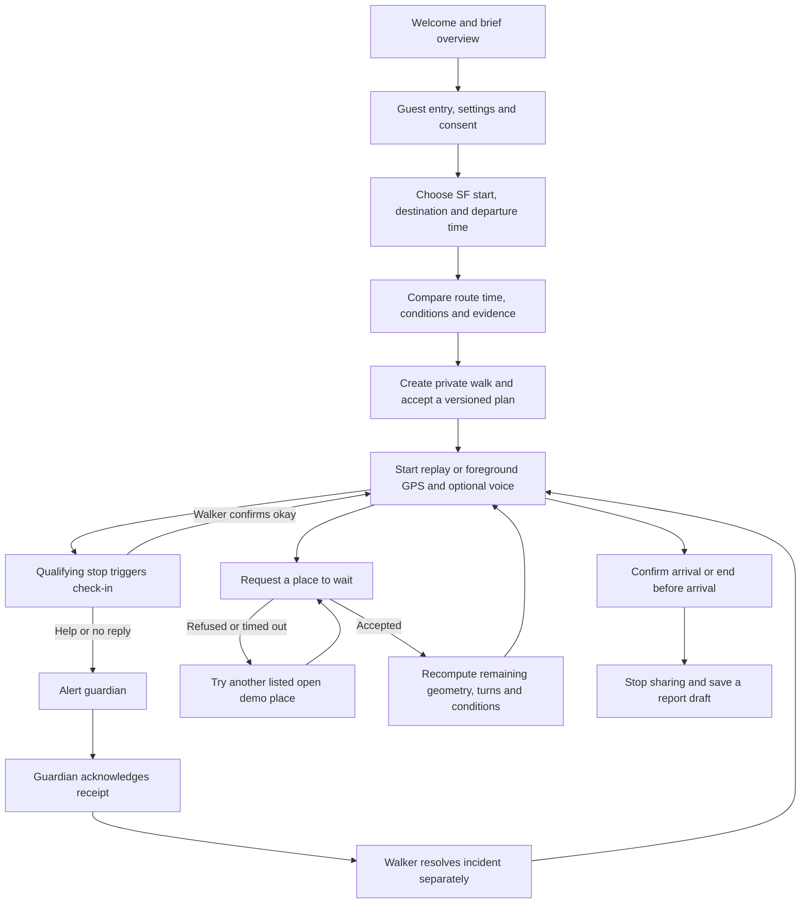
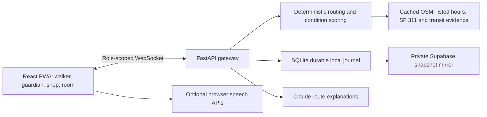

# JP workflow and implementation

## Branch boundary

The user's working branch is **JP**. Main's engine/API/frontend snapshot at `cec417264ba749d53c5ea0e9266df6d4b84acc3b` was merged into JP at `21373b9`. Code, migrations, documentation and pushes for this work stay on JP. Do not merge a PR into main without a new user request.

## Product workflow

Voice commands execute explicit deterministic actions. Unrecognized questions go to Claude with limited route facts; a model cannot generate a score, silently dispatch help, or override the action state machine. Guardian acknowledgment means receipt, not proof of wellbeing.

## Architecture

Use one gateway worker and persistent storage. The gateway is authoritative: it validates roles, rejects forged engine packets, persists accepted changes locally before delivery, and coalesces cloud writes off the alert path. Supabase is the private recovery mirror; browsers cannot read room tables directly. Separate role capability hashes and two-hour expiry protect room access. A private per-room invitation seed lets only the walker or control-room operator regenerate invitations on another device; guardian/shop roles cannot obtain those invitations. Treat the control-room link as private operator access. These links are bearer access and must stay private.

## Implemented behavior

| Area | JP implementation |
| --- | --- |
| Design | Existing colors, type, five mascots and screen components; added welcome/account/privacy and responsive finishing |
| Routing | Citywide SF search, current main engine, arrival-time hours, geometry/steps versioned on updates |
| Tracking | Server-owned replay; live GPS freshness/accuracy checks, off-route status, visible-page monitoring |
| Watcher/Rescuer | Server timers and restorable absolute deadlines, explicit help, guardian receipt, walker resolution |
| Places | Clearly simulated business role; wait/refuse/timeout/accept, new destination route, resume original goal |
| Evidence | Data provenance/unknowns, no crime input, no demographic danger proxy, no model-generated score |
| Reporting | Unverified observations and draft-only report; no automatic 311 or emergency submission |
| Voice | Browser recognition/synthesis, negation-aware explicit intents, bounded Claude answers and honest fallback |
| Persistence | SQLite journal, sequence-protected Supabase snapshot RPC, reconnect/redaction and room expiry |
| PWA | Manifest/icons, service worker prompt updates, cached fonts/map/replay, lazy screen loading |
| Dependencies | MapLibre 6 worker explicitly emitted by Vite; dependency audit clean at verification |

The original six-table Node relay foundation remains as a legacy development harness. It is not the normal PWA transport. The current app uses `services/api/pwa_gateway.py` and `pwa_rooms`; do not launch the relay on the gateway's port.

## Run and demonstrate

1. Build the frontend and start the FastAPI gateway as described in the root README.
2. Open `/`, choose settings, keep **Demo GPS replay** selected for the stage, consent, then choose a destination in `/plan`.
3. Review the route, invite the guardian from the walk sheet, open the private control room and shop view. The guardian accepts their invitation.
4. Start walking. The gateway advances replay. In the control room, **Demo: stop for check-in** makes the scenario repeatable. Normal thresholds are 90/45/90 seconds; replay scales them visibly.
5. Let the reply window expire, acknowledge from the guardian, and confirm okay from the walker. Receipt and resolution are separate events.
6. Request a place to wait, decline once from the shop, then accept the next request. All screens receive the revised geometry/turns/version. Continue to the original destination when ready.
7. End before arrival or confirm arrival. Guardian reconnect history omits live position/alert packets; collection stops. Reports remain drafts.
8. Use **Try the cached replay** for an offline demonstration after the PWA assets have been cached. It has no connected guardian, cloud storage or Claude.

## Configuration still needed outside the code

- **Google OAuth is deferred:** the user chose to skip authentication for this build. Guest entry is the normal flow. Optional OAuth code remains available for later provider configuration; it is not a completion blocker.
- **Public deployment:** one HTTPS origin, persistent disk and one backend worker. Set the deployment origin in OAuth redirects. No hosting deployment was assumed from access to GitHub alone.
- **Real participation:** business identity/authorization and a real partner network. Live GPS rooms refuse simulated shop commands.
- **Agentverse/ASI:** register and configure the existing adapters separately if needed for the pitch. A working local gateway is not proof of Agentverse deployment.
- **Field reliability:** phone background/push behavior and real street access need device and field validation. The PWA explicitly asks users to keep it visible.

## Verification

Automated checks cover the migrations/RLS/grants, sequence protection, private role capabilities, invalid packets, GPS freshness, hours across midnight, new route geometry, place refusal/acceptance, restored check-in deadlines, voice intent negation, distinct acknowledgment/resolution and location clearing.

The actual gateway/provider/cloud path is also checked with synthetic demo rooms; screenshots are local ignored artifacts. Production assets include the MapLibre module worker, offline SF street geometry and map font PBFs. CI runs on pushes to JP only.

Verified October 24, 2026: **18 frontend/database checks, 11 Python gateway checks, 23 local Agent Chat Protocol checks**, production TypeScript/build and **zero npm audit findings**. A synthetic real-WebSocket run exercised check-in → guardian alert/receipt → walker resolution, place refusal → alternate acceptance → versioned geometry, and ended-history redaction. The application endpoint returned a real Claude answer. A fresh empty SQLite journal recovered a room from the hosted Supabase mirror. The production PWA reloaded and ran its labelled cached replay with the HTTP gateway stopped. Phone layouts were inspected at 390 × 680.

Main independently advanced to `aa74dc6` during verification. This JP work remains based on the reviewed `cec4172` snapshot and does not include that later parallel backend rewrite. See the handoff before reconciling implementations.
