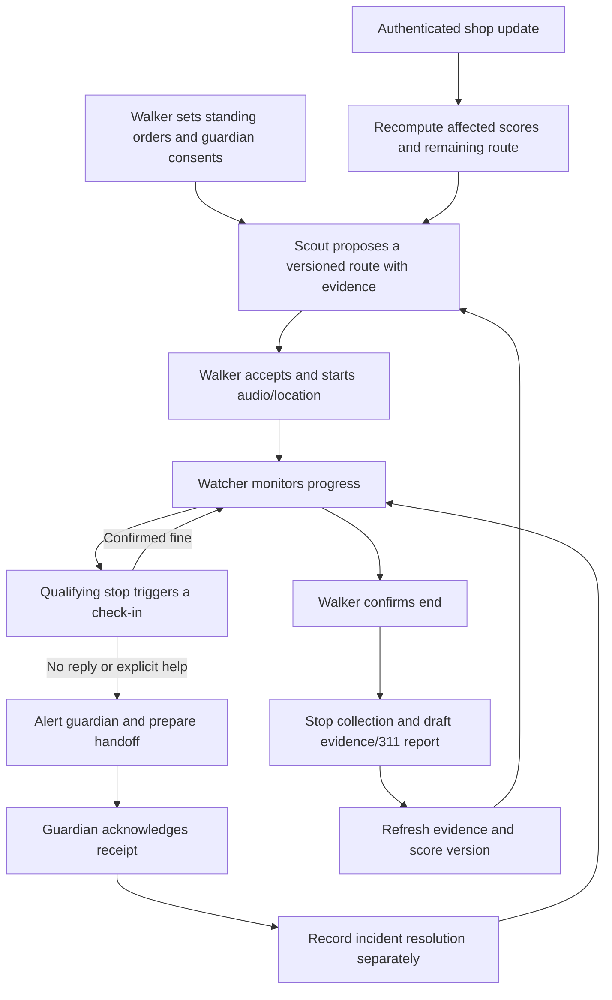
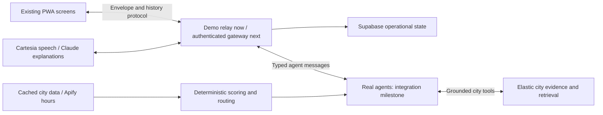

# Streetwise workflow based on the repository

## Branch boundary

Source reviewed: GitHub `main`, commit `519db43` (`Add Streetwise web PWA`). The actual GitHub Desktop checkout is already on `JP`; that is the only branch this work changes or publishes. Existing frontend source/design is retained.

Another remote branch, `engine-demo-data`, contains a Python engine, FastAPI gateway, agents, hours pipeline, and cached datasets. It was inspected as context, not merged. Its README describes a different deterministic scoring model. Integrating that work requires agreeing on contracts and score definitions; do not silently combine its numbers with this branch's fixture statistics.

## What is actually implemented

| Area | On the reviewed main | JP foundation |
| --- | --- | --- |
| Screens | Walker, guardian, shop, room, setup, hub | Existing screens retained |
| Map/data | MapLibre and one cached demo corridor | Existing fixture retained; four places seeded as unverified demo records |
| Agent behavior | Browser `DemoEngine` plays five named agent roles | Same labeled demo behavior; no claim of five deployed agents |
| Voice | Browser recognition/synthesis, replacement hooks | Retained; Cartesia remains an integration task |
| Realtime | WebSocket relay plus same-device BroadcastChannel | Validated envelopes and isolated room history |
| Persistence | In-memory history only | Supabase event log, session projection, incidents, shop state, report drafts |
| Shop toggle | Changes demo scores and narration; does not recompute geometry | Updates are persisted; real routing recomputation remains a task |
| Safety timers | Browser-owned demo timers | Persisted deadlines; backend timer execution remains a task |
| Guardian access | Room ID in URL; UI hides position after ending | Reconnect history strips ended-walk locations; scoped identity/consent still required |
| City intelligence | Cached explanations and simulated audit | Drafts persist; live evidence/retrieval/audit remain integrations |

The fixture's advertised 60/49 scores and 44/115 m comparison are carried over from the supplied data spike. `main` does not contain the scoring script that reproduces them. Do not represent a fixture comparison as a fresh pipeline measurement.

## Product flow

Guardian acknowledgement means receipt, not proof the walker is safe. No automatic emergency calls or city submissions exist.

## Architecture and data ownership

Supabase stores operational records. Elastic remains the intended city evidence and retrieval layer. Avoid two independent realtime systems: keep the current gateway WebSocket as the screen transport. No Supabase secret belongs in the browser bundle.

Existing contracts in `streetwise-web/src/lib/types.ts` remain the integration boundary. The database gives events an authoritative per-walk sequence and reset generation without changing the client envelope. Persist an event and its state projections in one transaction. Socket delivery must not wait on a slow database write.

## Build gates

### Gate 1 — persistent demo foundation (this change)

Deliver: schema/migration, labeled fixture seed, optional relay persistence, reconnect history, incident/report projections, private database access, environment guide, tests, and a successful production build.

Proof: two clients receive one event; duplicate IDs do not duplicate database records; relay restart recovers accepted history; guardian acknowledgement leaves the incident unresolved; ending a walk removes location from future room history; report rows cannot become submitted reports.

This is demo persistence, not a production safety service. SQL tests execute real PostgreSQL semantics through PGlite because Docker is installed but its daemon was not running on this machine.

### Gate 2 — identity, consent and authoritative gateway

1. Add walker authentication, guardian opt-in, scoped expiring guardian links, and authenticated place-owner/control-room access.
2. Move state transitions and deadlines out of `DemoEngine` into the gateway. Restore outstanding deadlines after restart.
3. Authenticate each socket and authorize each command. A `role=guardian` URL is not authentication. Add incident IDs and route versions so stale replies/instructions cannot affect a newer incident or route.
4. Add location fix time, received time, accuracy and tracking health. Missing fixes are not proof of a stop.
5. Expire live subscriptions on walk end and provide retention/cleanup for live data. Render ended/incident outcomes separately from arrival. Only then enable actual GPS persistence.

Proposed timer interpretation: 90-second qualifying stop → ask → 45-second reply window → guardian alert → 90 seconds without acknowledgement prepares the next consented handoff step. Explicit Help/SOS bypasses passive waits. These are configurable prototype defaults, not validated response thresholds.

Claude may interpret a response or explain context. Deterministic backend rules own timers and escalation. Uncertain speech does not count as a confirmed all-clear.

### Gate 3 — real routing and the shop interaction

1. Integrate a reproducible scoring/route export with a declared scoring version.
2. Keep source evidence, observation time, confidence and unknown components with each segment.
3. Process `place.update` through a real place agent, recompute affected components, and search the remaining route from the current position.
4. Publish new geometry, statistics and turn instructions with one route version.
5. Test a fixture where a legitimate shop change alters the preferred route; avoid changing geometry only in the UI.

An open shop is not automatically a verified haven or proof that its light works. A historical lamp report does not establish current lighting. Retain that distinction in the explanation cards.

### Gate 4 — voice and sponsor integrations

Integrate one working path at a time: Cartesia speech → Claude reply → registered Scout/Watcher/Rescuer exchanges → Elastic tool retrieval → Apify hours. ASI:One invokes the same domain functions as PWA commands.

Show real provider calls and tool outputs in the trace. Keep simulated responses labeled. Measure speech-end to first audible output on the chosen phone and earbuds. Keep tap-to-talk and large response buttons available.

### Gate 5 — reporter, audit and submission

Turn observations into source-linked evidence, keep 311 reports as drafts, run the auditor against refreshed or explicitly cached evidence, and label any simulated walker exposure. Schedule an overnight job only after its callable version works.

Then freeze features, complete five cold-start rehearsals, record the backup and submission videos, and finish the README/prize evidence. Confirm sponsor-specific entry requirements against this event, not the proxy hackpack.

## Ownership and integration rhythm

| Owner | Workstream | First shared interface |
| --- | --- | --- |
| Voice | Walker, browser audio, location, wake lock, replay | Start, position, response and SOS commands |
| Brain | Gateway, authorization, deadlines, real agents | Validated events and current session snapshot |
| City | Route engine, evidence, Elastic, Apify | Versioned geometry, scores and source facts |
| Face | Guardian/shop/room, visual polish, pitch/video | Screens consuming the same events |

Agree on schemas together, then work in parallel within a gate. Integrate every two hours. Let one teammate verify sponsor requirements while the other three build. Skip completed gates; cut stretch work before reducing hardening time.

## Modes and rehearsal checks

| Mode | Location | Backend behavior | Honest label |
| --- | --- | --- | --- |
| Local demo | Cached replay | Browser engine, relay, optional Supabase | Demo GPS replay; simulated agent roles |
| Connected demo (next) | Cached replay | Real agents/providers and authenticated gateway | Demo GPS replay; actual provider trace |
| Live (after Gate 2) | Phone GPS | Authenticated gateway and authoritative timers | Fix age, accuracy and tracking status |

The current demo relay rejects live location/start commands. Use a real gateway for live mode. Cached assets alone cannot deliver a cross-phone guardian alert. Walker and guardian pages need a working connection and foreground operation for the prototype; background delivery is not guaranteed.

Before presenting: exercise a reply, silence, Help, guardian acknowledgement, separate resolution, shop update, reconnect, database outage, walk end and a cold restart. Keep a visible fallback status and a recorded full-flow backup.

The [official deadline](https://cal-hacks-13-0.devpost.com/) is Sunday, October 25, 2026 at 9 AM Pacific. Arrive by 8 AM and target submission by 8:15 AM. Protect time for rehearsal, the submission draft and rest; do not rebuild the already implemented screens.
